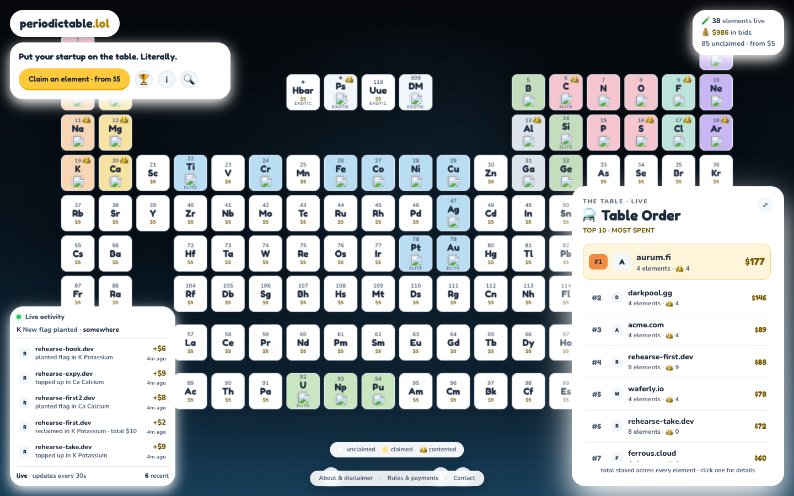
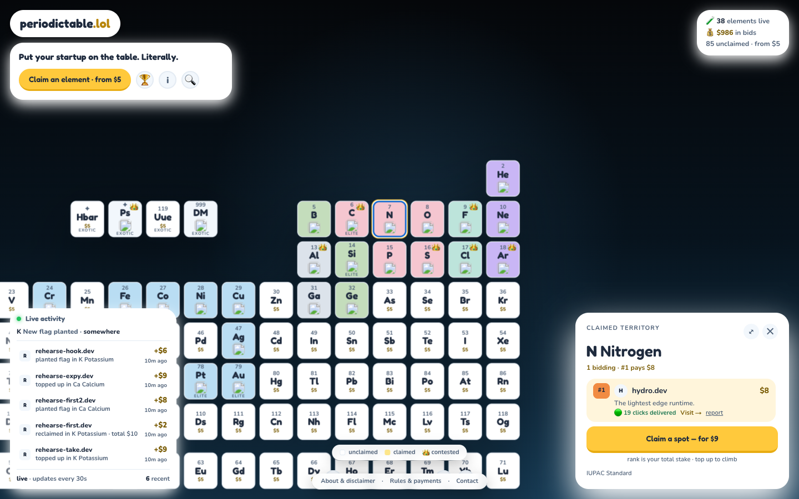
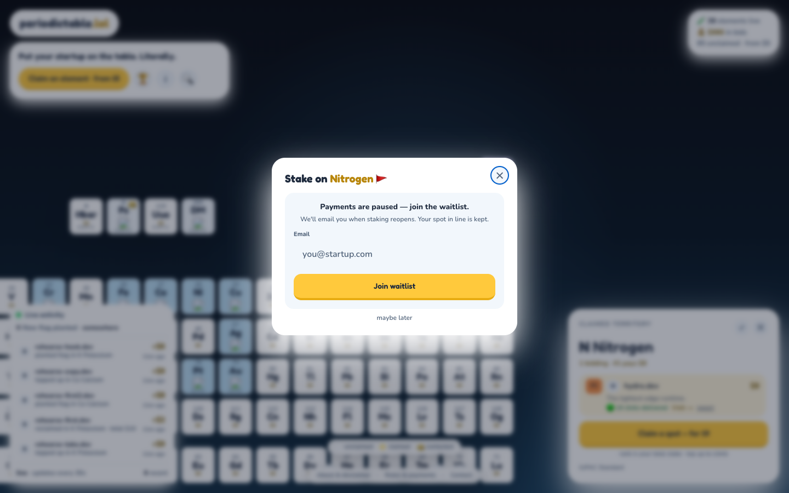

# periodictable.lol

**King-of-the-Hill staking ads on a living periodic table.**

**[Live site](https://periodictable.lol)** · [Architecture](doc/ARCHITECTURE.md) · [Design system](doc/DESIGN-SYSTEM.md) · [Operator runbooks](ops/README.md)



Every element is an open, multi-tenant leaderboard ranked by total stake. A
startup plants a flag from **$5**, takes the **#1 crown** by paying $1 over the
current leader, gets outbid, and tops up to reclaim it. Tiles never sell out —
unlimited stakers share an element, and the leader owns the tile face while
everyone else lives ranked in the drawer.

---

## What it does

- **122 nodes** — the 118 IUPAC elements plus four theoretical exotics in the
  row-2 gap: Antihydrogen (−1), Positronium (0), Ununennium (119), Dark Matter
  (∞).
- **One $5 floor everywhere.** No tiers, no auctions, no sold-out states.
- **Cumulative equity.** Stake never expires. Reclaim =
  `(current leader + $1) − your prior stake`.
- **Real money, real invariants.** Stripe Checkout in, atomic settlement out.
- **A board, not a mockup.** Search, rankings, live activity, startup profiles,
  moderation, email receipts, and the operator tooling to run all of it.



---

## Engineering highlights

- **Atomic settlement.** Provider-event claim, stake + aggregates, paid
  transition, and outbox enqueues commit in one transaction (`lib/settle.ts`).
  Same delivery twice applies once (event-id dedupe); webhooks accept paid
  signals only from an explicit allowlist.
- **One pricing source.** `lib/pricing.ts` owns every dollar figure. Each stake
  application takes a per-element lock, asserts one leader and gap-free ranks,
  and logs the delta to the activity feed before committing.
- **Fail-closed launch flags.** Production payments run only when explicitly
  enabled *and* both provider keys are present (`lib/flags.ts`). A missing or
  partial config renders the waitlist, never a free stake.
- **Operator-grade ops.** Ten-plus runbooks with executable queries, a launch
  gate, reconciliation jobs, and audited admin endpoints (`ops/`).
- **Accessibility is tested, not claimed.** Focus-trapped modals, a 122-tile
  table that is one tab stop with arrow-key navigation, AA-passing tokens, and
  an axe audit in the suite.
- **66 Vitest suites** covering money paths, webhook unwinds, ledger integrity,
  API contracts, moderation, accessibility, and the docs themselves.



---

## Stack

| Layer | Choice |
| --- | --- |
| App | Next.js 14 (App Router) + React 18 + Tailwind CSS |
| Data | Prisma 6 + Postgres 16 (Neon in production) |
| Payments | Stripe Checkout + webhooks |
| Email | Resend |
| Bot checks | Cloudflare Turnstile |
| Rate limits | Upstash Redis (memory fallback locally) |
| Hosting | Vercel |

---

## Quick start

```bash
npm ci
cp .env.example .env        # fill in DATABASE_URL
npx prisma migrate deploy
npx tsx prisma/seed.ts      # 122 elements + 11 inventory seats (optional)
npm run dev                 # http://localhost:3000
```

Any Postgres 16 works — a pooled Neon/Supabase URI for serverless, or
`postgres:16-alpine` in Docker for offline work. With no Stripe keys, checkout
falls back to a local dev payment simulator.

---

## Environment

The full list, with production requirements, lives in `.env.example`. The ones
that change behavior:

| Variable | Development | Production |
| --- | --- | --- |
| `DATABASE_URL` | required | required |
| `STRIPE_SECRET_KEY` / `STRIPE_WEBHOOK_SECRET` | optional (absent = dev pay simulator) | **required** |
| `STRIPE_WEBHOOK_SECRET_OLD` | unset | only during a rotation overlap; see `ops/secrets.md` |
| `NEXT_PUBLIC_APP_URL` | defaults to localhost | **required, https** |
| `TURNSTILE_SECRET` | optional (absent = checks pass) | **required** |
| `CLICK_SALT` | dev default | **required, private random** |
| `CRON_SECRET` | optional | **required** |
| `RESEND_API_KEY` / `EMAIL_FROM` | optional (absent = emails logged) | **required** |
| `PAYMENTS_LIVE` / `NEXT_PUBLIC_PAYMENTS_LIVE` | default live (simulator) | **fail-closed**: `"true"` **and** both Stripe keys |

Production config is validated by a fail-closed gate:

```bash
node scripts/check-prod-env.mjs
VERCEL_ENV=production NODE_ENV=production node scripts/check-prod-env.mjs
```

---

## Scripts

| Command | What it does |
| --- | --- |
| `npm run dev` / `build` / `start` | run / production build / serve |
| `npm run lint` / `npm run typecheck` | ESLint / `tsc --noEmit` |
| `npm test` | Vitest: unit + DB integration |
| `npm run test:ci` | Vitest, capped workers (what CI runs) |
| `npm run check-prod-env` | fail-closed production config gate |
| `npm run audit:prod` | production dependency audit vs `ops/accepted-advisories.json` |
| `npm run db:migrate` / `db:deploy` | `prisma migrate dev` / `deploy` |
| `npm run db:clear-inventory` | remove seeded launch seats (dry run by default) |
| `npm run db:check-board` | print the live launch board |
| `npm run db:erase-subject` | GDPR-style subject erasure |

DB integration tests run only against a localhost Postgres (or with
`VITEST_ALLOW_REMOTE_DB=1`), so fixtures can never touch shared data. CI
provides an ephemeral Postgres service.

---

## Database

```bash
npx prisma migrate deploy                 # clean deploy / production
npx prisma migrate dev --name <change>    # local schema iteration
npx prisma validate && npx prisma format --check
```

`prisma/migrations/0000_baseline/` matches `prisma/schema.prisma` exactly and is
verified by `migrate deploy` on an empty database plus seed. Later migrations
must preserve existing stakes, payments, clicks, reports, and email logs.

---

## How the money works

An **empty element** starts at $5. A **claimed element's** only entry price is
the takeover ($1 over the holder's total), and the holder pays just the gap to
take the lead back. Nothing holds an element between checkout and payment: two
equal payments can land at the same moment, and the earlier-settled stake keeps
the higher rank. The ledger is append-only in spirit — financial history is
never deleted, and aggregates keep counting hidden stakes.

Reading the resulting rows is its own skill: `doc/PAYMENT-LEDGER-SHAPES.md`
explains the twelve rows in five shapes that a `psql` prompt will show you.

**Payments are fail-closed.** `PAYMENTS_LIVE=true` is required in production,
together with both Stripe keys, or checkout returns `403 { waitlist: true }`.

---

## Project layout

```
app/            Next.js routes, pages, and API handlers
components/     Board, tiles, drawer, modals, chrome
lib/            Pricing, settlement, API contracts, moderation, ops logic
prisma/         Schema, migrations, seed data, launch seed list
scripts/        Release rehearsal, env gate, audits, one-off DB tools
doc/            Architecture, design system, roadmap, element data, ledger shapes
ops/            Operator runbooks, launch gate, launch-week queries
```

---

## Testing and CI

`npm test` runs the Vitest suite: unit tests plus database-integration tests
that are skipped unless a test database is reachable. CI
(`.github/workflows/ci.yml`) installs, validates and formats the Prisma schema,
runs migrations on ephemeral Postgres, lints, type-checks, runs the tests
(failing if any DB test skips), audits production dependencies, checks the
production env gate both ways, and builds with a database attached.

---

## Documentation

| Document | What it covers |
| --- | --- |
| [`doc/ARCHITECTURE.md`](doc/ARCHITECTURE.md) | System shape, data flow, and the invariants |
| [`doc/ROADMAP.md`](doc/ROADMAP.md) | Product decisions and the build plan |
| [`doc/DESIGN-SYSTEM.md`](doc/DESIGN-SYSTEM.md) | Visual authority — wins any look conflict |
| [`doc/ELEMENT-DATA.md`](doc/ELEMENT-DATA.md) | The 122-node dataset and its rules |
| [`doc/PAYMENT-LEDGER-SHAPES.md`](doc/PAYMENT-LEDGER-SHAPES.md) | How to read the `Payment` table |
| [`ops/README.md`](ops/README.md) | Index of every operator runbook |
| [`ops/launch.md`](ops/launch.md) | The launch gate and deploy/pause procedure |

---

## Ownership

**v1: a listing is set at checkout and is final.** Identity is derived
server-side from the validated URL or handle (`findOrCreateCheckoutStartup`),
and checkout never mutates an existing startup profile — a later stake on the
same domain only adds stake. What the buyer submits is what ships.

Editing an existing listing is not shipped in v1. The magic-link backend
(`lib/manage.ts`, `/api/manage/*` → `PATCH /api/startups/[domain]`) exists and is
tested, but has no UI and production never emails the link, so it stays dormant
and unreachable. Every mutation writes an `AuditLog` row.

---

## Accessibility

Modals trap focus, inert the background, own Escape, and restore the exact
trigger. Checkout is a labeled form with described errors and polite async
announcements. The 122-tile table is one tab stop with arrow/Home/End navigation
and Escape back to search. Small text uses AA-passing `*-ink` tokens (verified by
`lib/a11y.test.ts` plus an axe audit), touch layouts get 44px targets, reduced
motion kills camera/ping/modal movement, and legal links render on every
viewport.
